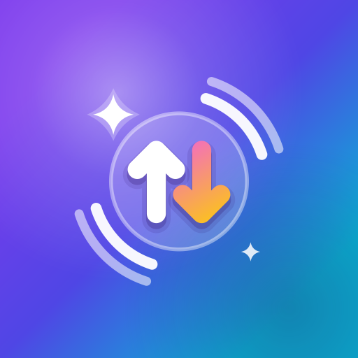
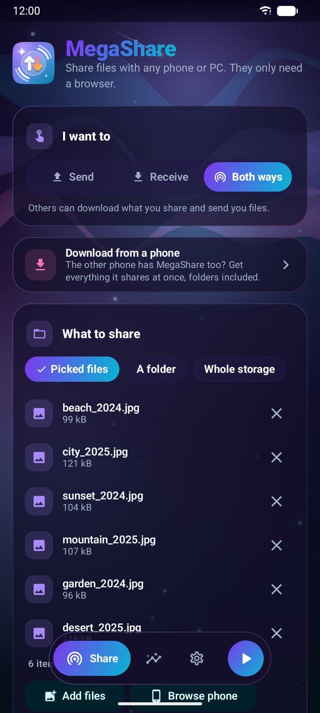
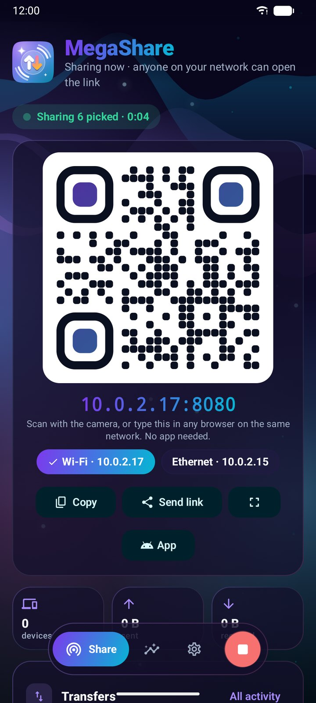
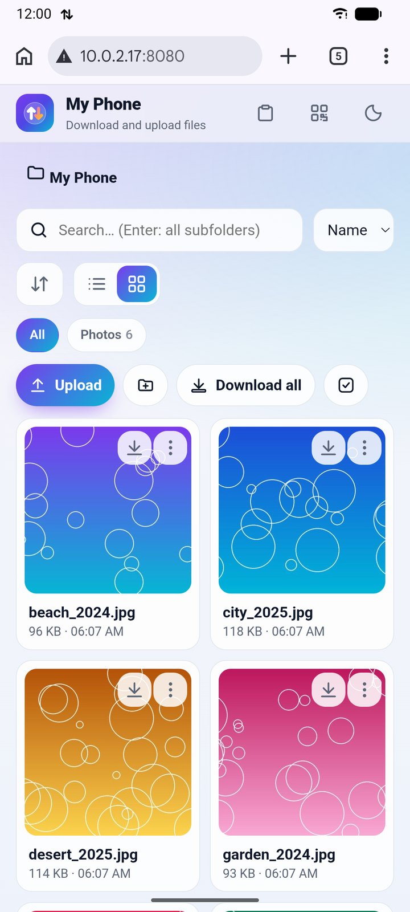
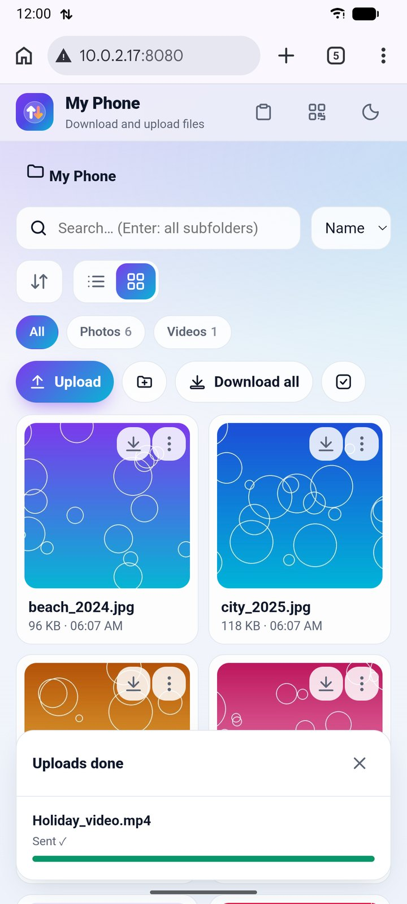
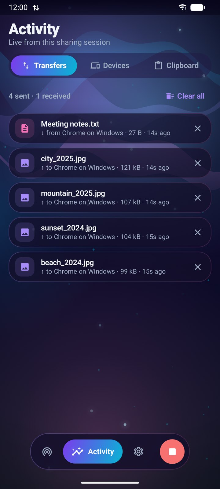
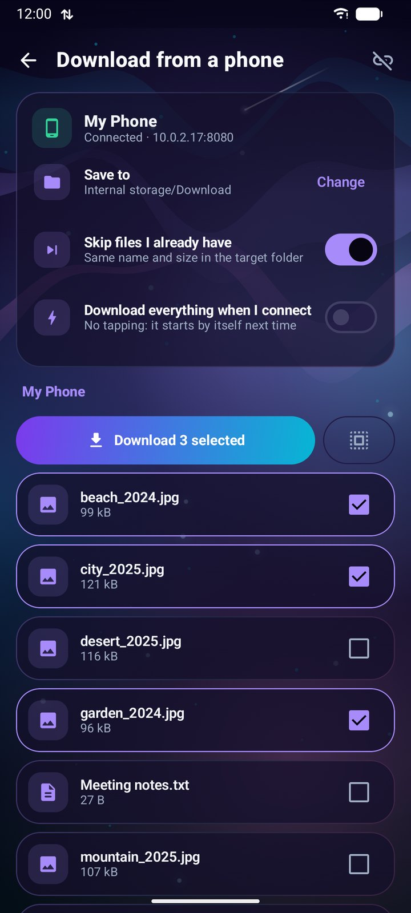
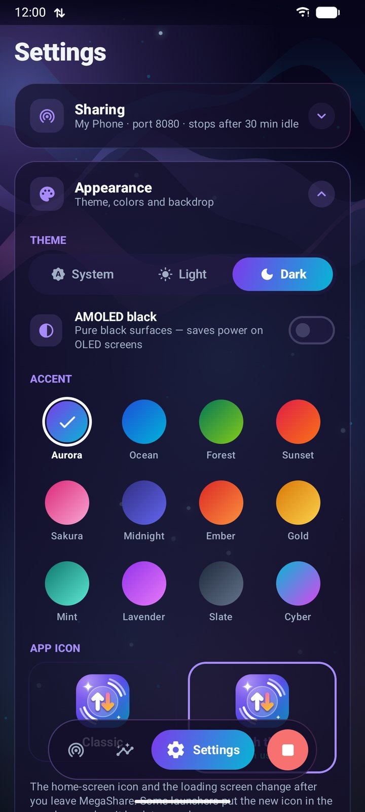
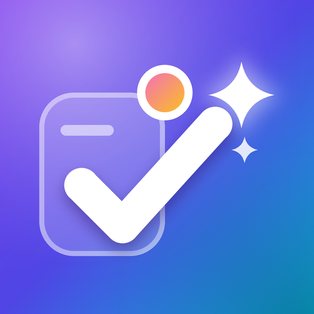

  

<h1 align="center">MegaShare</h1>

<b>Share files from Android with any phone or computer. They only need a browser.</b> 
Wi-Fi or hotspot · QR code and link · download and upload in any browser · folders and big files · no internet, no account, no app on the other side

  <a href="https://github.com/MegaMind2999/MegaShareApk/releases/latest/download/MegaShare.apk"><b>⬇ Download MegaShare.apk (latest)</b></a>
  &nbsp;·&nbsp;
  <a href="https://github.com/MegaMind2999/MegaShareApk/releases/latest">Release notes</a>
  &nbsp;·&nbsp;
  <a href="https://megamind2999.github.io/MegaShareApk/">Website</a>

Free · No ads · No tracking · Android 7.0+ · phones and tablets

---

## What is MegaShare?

MegaShare turns your Android phone into a private file page on your Wi-Fi or hotspot. Pick what to share, show the QR code, and anyone on the same network opens it in their browser on an iPhone, Android, Windows, Mac or Linux device. They can browse, preview and download what you share, or send files and whole folders to you. Nothing to install on their side, and nothing goes through the internet.

**Quick Share didn't find the other phone again?** Quick Share sometimes can't see the other device, it hides under different names and menus on different Android brands, and it needs Quick Share on both sides. MegaShare is the easier way: a QR code any browser understands.

  
  
  
  
  
  
  

## Features

**Sharing**
- Send, Receive or Both ways, with separate switches for download, upload, rename/new folder, delete and hidden files, all changeable while sharing
- Share picked files, one folder, or the whole storage including the SD card; add or remove files while sharing, or use “Share” from any app
- Big QR code, full-screen QR, copy or send the link, and a choice of address when the phone has more than one network
- Optional PIN, live list of devices with Block, auto-stop when idle, Quick Settings tile, start/stop button on every tab

**No Wi-Fi? Bring your own network**
- Quick hotspot started by the app, with a Wi-Fi QR code so others join without typing
- Phone hotspot: open, or a simple 8-digit password that stays the same until you change it
- Hotspot while on Wi-Fi when the phone supports it; otherwise MegaShare asks you to turn Wi-Fi off
- Warns about a VPN only if it really blocks other devices

**In the visitor's browser (no app)**
- List and grid views with thumbnails, sorting, filters by type, search in all subfolders
- Photo gallery with swipe; videos and music play and skip right away
- Upload files or whole folders with drag and drop, progress and speed
- Download a folder or a selection as one zip; rename, new folder, delete (if you allow it)
- Shared clipboard both ways, dark mode, and “Get the app” to install MegaShare from your phone

**Phone to phone (MegaShare on both)**
- Find nearby phones, scan the page QR or the hotspot Wi-Fi QR, or type the address
- Download everything shared, folders included, with progress, speed, time left and resume; files you already have are skipped
- Optional “Download everything when I connect”

**Everything else**
- Light, dark and AMOLED themes, 12 accent colors with a matching app icon and loading screen, 10 animated backgrounds; phone and tablet layouts
- Updates itself from GitHub; on Android 12+ later updates install without a prompt, and never while you're sharing
- Battery friendly: nothing runs when you're not sharing
- Private: no accounts, ads, analytics or servers; files stay on your local network

## Install

1. Download [**MegaShare.apk**](https://github.com/MegaMind2999/MegaShareApk/releases/latest/download/MegaShare.apk) on your Android phone.
2. Open it and, if Android asks, allow installing apps from your browser or file manager.
3. To update, let MegaShare update itself, or install the newer APK over the old one.

## Privacy and terms

- [Privacy Policy](https://megamind2999.github.io/MegaShareApk/privacy.html)
- [Terms of Use](https://megamind2999.github.io/MegaShareApk/terms.html)

## More from MegaMind

**[MegaDo](https://megamind2999.github.io/MegaDoApk/)**: tasks, notes and reminders for Android, with alarms, location reminders, rich notes and Google Drive sync.
 

## Feedback

Found a bug or have an idea? [Open an issue](https://github.com/MegaMind2999/MegaShareApk/issues).

---

© 2026 MegaMind. All rights reserved. MegaShare is free for personal use; see the [Terms of Use](terms.html).
